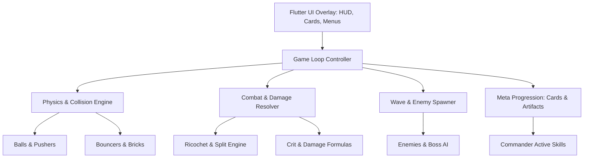

# Bounce Defense

An open-source recreation and port of **Bounce Defense** built with Flutter and 2D physics simulation.

---

## 📌 Project Overview

**Bounce Defense** is a hybrid casual game blending **Pinball / Brick-Bounce physics** with **Tower Defense wave survival** and **Roguelike deck-building / artifact progression**. 

The player defends against incoming waves of ground and air enemies by launching and bouncing projectile balls through a field of strategic bouncers, triggers, and pins. Each bounce multiplies damage and triggers weapon effects, while commanders and tactical cards provide active field control.

The original game reference artifact is located in [`tmp/Bounce Defense.apk`](file:///c:/Users/ammar/Desktop/Jangan%20sentuh/bounce_defense/tmp/Bounce%20Defense.apk), an Android package (`com.minigamelab.bouncedefense`) built on Unity 6 (IL2CPP metadata v39). This project reverse-engineers its core game loops, balance formulas, and mechanics to implement a clean, high-performance Flutter-native game.

---

## 🎮 Core Game Mechanics & Systems

Through static metadata analysis of the reference build, the game engine is structured around several interconnected subsystems:

### 1. Ball & Bounce Physics (`BallSystem` & `BouncerSystem`)
- **Balls**: Controlled projectiles spawned at specific spawn cells (`BallSpawnCell`), driven by speed curves, ball pushers (`BallPusher`), and direction modifiers (`BallDirection`).
- **Bounce Damage Scaling (`BounceCountAddDPS`)**: Every registered collision with a bouncer, wall, or brick increases ball kinetic power and applies damage multipliers to nearby targets.
- **Bouncers**: Interactive pegs/bumpers with variable shapes (`BounceShape`), starting and max fill counters (`BouncerStartingFillCount`, `BouncerMaxFillCount`), and bounce speed boosts (`BounceSpeedMultiplierList`).
- **Bricks & Obstacles**: Destruction grids (`Brick`, `BricksDisplay`, `BrickChunkAlloc`) that obstruct paths and provide score/coin rewards when shattered.

### 2. Enemies, Waves & Boss Encounters (`EnemySystem`)
- **Spawn Waves**: Structured wave spawns (`ActiveSpawnWave`) featuring melee walkers, ranged casters, and summoners.
- **Enemy Attack Behaviors**:
  - `EnemyArcaneMageAttackSystem`: Long-range spellcasting projectiles.
  - `EnemyBulletPool`: Bullet absorption and ricochet counter-play (`EnemyBulletAbsorber`).
- **Boss Archetypes & Phases**:
  - **Bouncing Durian** (`BossBouncingDurian`): Erratic heavy ricocheting boss.
  - **Flying Laser Bird** (`BossFlyingLaserBirdAttackSystem`): Aerial boss charging sweeping beam attacks.
  - **Moving Summoner** (`BossMovingSummonerAttackSystem`): Dynamic spawner advancing along lanes.
  - **Multi-Shoot & Splitting Summoner** (`BossMultiShootAttackSystem`, `BossSplittingSummonerAttackSystem`).
  - **Shield Mechanics** (`BossShieldEntity`, `BossShieldHolder`).

### 3. Combat, Weapons & Projectiles (`CombatSystem`)
- **Bullet Ricochet & Split**: Configurable chances for projectiles to bounce (`BulletRicochetChancePercent`) and fork into multiple child projectiles upon impact (`BulletSplitChancePercent`).
- **Status Effects**: Burning, freezing, poison, and slowing status debuffs (`BulletStatusEffect`, `DamageDebuffMultiplier`).
- **Critical Strike System**: Multiplicative critical strike formulas (`CritChance`, `CritDamageMultiply`, `CritDamagePerTick`).

### 4. Meta-Progression & Upgrades (`MetaSystem`)
- **Commander Abilities**: Hero characters equipped with active tactical abilities:
  - `CommanderAbilityBarricade`: Deployable physical roadblock to protect the core.
  - `CommanderAbilityLaser`: Direct high-DPS targeting beam.
  - `CommanderAbilityMeteorShower`: Area-of-effect wave clearer.
- **Card Choice & Drafting** (`CardChoiceSystem`): In-run roguelike drafting allowing players to choose power-ups, extra balls, attack speed, or passive buffs between waves (`CardPool`).
- **Artifacts & Relics** (`ArtifactDataManager`): Persistent collectable artifacts (`ArtifactConfigTable`) providing permanent passives, unlocked via chests and milestone stages (`ArtifactLevelUpDialog`).

---

## 🛠️ Architecture & Tech Stack

- **Framework**: [Flutter](https://flutter.dev/) (SDK `^3.13.7`)
- **Game Engine**: [Flame](https://flame-engine.org/) or Flutter Canvas/Forge2D for rigid-body bounce simulation
- **State Management**: Riverpod or BLoC
- **Audio & FX**: `audioplayers` with particle canvas systems
- **Target Platforms**: Android, iOS, Windows, macOS, Linux, Web



---

## 📁 Repository Structure

```
bounce_defense/
├── lib/
│   ├── main.dart             # Application entrypoint
│   ├── core/                 # Shared utilities, constants, audio, base classes
│   ├── game/                 # Flame/Canvas game loops, world, components
│   │   ├── actors/           # Balls, Bouncers, Bricks, Enemies, Bosses
│   │   ├── abilities/        # Commander abilities (Laser, Barricade, Meteor)
│   │   ├── combat/           # Damage calculators, bullet pooling, ricochet logic
│   │   └── waves/            # Wave configurations, enemy spawners
│   ├── models/               # Data classes: Artifacts, Cards, Commanders, Enemies
│   └── ui/                   # Menus, HUD, Card Choice Dialogs, Shop, Artifact Screen
├── test/                     # Unit, physics, and gameplay tests
├── tmp/                      # Reference APKs and extracted assets (gitignored)
│   └── Bounce Defense.apk    # Reference Unity 6 build (com.minigamelab.bouncedefense)
├── AGENTS.md                 # Agent guidelines, protocols, and developer notes
└── pubspec.yaml              # Flutter dependencies and assets
```

---

## 🚀 Getting Started

### Prerequisites
- [Flutter SDK](https://flutter.dev/docs/get-started/install) (3.13+ or latest stable)
- Java JDK 17+ and Android SDK (for mobile targets)

### Run the App
```bash
# Get dependencies
flutter pub get

# Run on available device or desktop
flutter run
```
